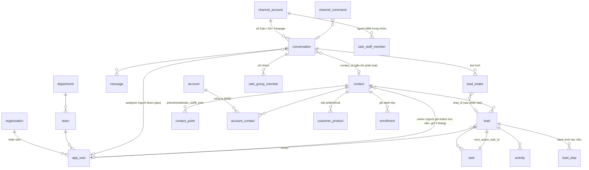

# Kiểm tra: hội thoại chatbot đổ vào dữ liệu CRM như thế nào

Ngày 14/10/2026. Chỉ đọc code và D1 eval (chỉ chạy SELECT), không sửa gì. Giờ ghi theo UTC, giờ Việt Nam = UTC + 7.

## Kết luận nhanh

- **Lead đã được tạo thật, chỉ là màn hình không cho thấy.** Khi nhân viên phân loại một "lead chờ phân loại", CRM tạo khách, lead học viên, việc cần làm (task) và ghi chú hội thoại. Hội thoại cũng được gắn với khách. Nhưng khung bên phải của Inbox chỉ hiện lead *đang chờ*. Sau khi tạo xong, khung này hiện chữ "Chưa có" và mời bấm "Cập nhật CRM". Ngoài ra, lead học viên không có trong "Danh sách lead", "Pipeline" hay "Tổng quan" (các trang này chỉ hiện lead B2B). Vì vậy chủ doanh nghiệp tưởng không có gì thay đổi.
- **Lead bị trùng là do thiết kế.** Khi một lead chờ đã được xử lý, mỗi lần trích lại (bấm "Cập nhật CRM", trả lại AI, chuyển người, hoặc khách im 15 phút) sẽ tạo một lead chờ *mới*. Lệnh tạo lead học viên cũng không chặn trường hợp khách đã có lead đang mở. Chính chuỗi này tạo ra L-0047 rồi L-0048. Hội thoại [khách A] đã có tin mới lúc 07:35, nên khoảng 07:50 UTC hệ thống sẽ tự tạo lead chờ thứ ba.
- **Tin Lark bị kẹt không thử lại mãi.** Đó là tin nhắn riêng báo cho Lâm Mai rằng chị được giao hội thoại. Hệ thống thử tối đa 5 lần (cách nhau 2, 4, 8, 16 phút) rồi đánh dấu lỗi. Nguyên nhân là app Lark chưa cho phép người dùng này nhận tin (phạm vi khả dụng của app). Đây là việc cần chỉnh cấu hình Lark. Code chỉ nên dừng thử lại khi gặp lỗi kiểu này và báo rõ.

---

## 1. Cấu trúc dữ liệu

Giải nghĩa các bảng:
- **contact (khách)**: một người.
- **contact_point (điểm liên lạc)**: SĐT, email, mã Zalo hoặc mã Facebook của khách đó.
- **lead (cơ hội bán)**: một lần khách có nhu cầu. Mỗi lead thuộc một trong hai "pipeline" (luồng bán): `b2b` (bán cho doanh nghiệp) hoặc `learner` (học viên).
- **task (việc cần làm)**: việc gắn với một lead. Lead đang mở bắt buộc phải có một "Next Action" là một task đang mở.
- **activity (hoạt động)**: nhật ký của lead, chỉ được ghi thêm, không sửa.
- **conversation (hội thoại)** và **message (tin nhắn)**: chat từ các kênh.
- **lead_intake (lead chờ phân loại)**: thông tin bot trích từ hội thoại, đợi nhân viên quyết định.
- **channel_command (hàng lệnh)**: các việc chạy sau, ví dụ gửi Zalo, chạy bot, gửi Lark.

Những điểm cần nhớ:
- Bot **không bao giờ** tự tạo contact hay lead. Bot chỉ ghi vào `lead_intake`. Nhân viên phân loại thì CRM mới gọi lệnh `createLead` hoặc `createLearnerLead` (`apps/crm/src/worker/inbox/intake.ts:9-13`).
- `conversation.contact_id` chỉ được ghi khi phân loại hoặc khi bấm "Gắn vào khách có sẵn" (`intake.ts:253-263`). Khi tin nhắn đến, CRM không tự nhận ra khách cũ.
- Mã Zalo (`zalo_uid`) và mã Facebook (`fb_psid`) có được *ghi* vào contact_point nhưng **không chỗ nào đọc lại**. Cả repo chỉ có một chỗ dùng: `intake.ts:254`.

## 2. Luồng chatbot đổ vào CRM, theo từng kênh

| Bước | Zalo cá nhân 1-1 | Zalo OA | Facebook Messenger | Nhóm Zalo |
|---|---|---|---|---|
| Tin đến | Bridge gửi sự kiện, đi vào `ingestMessage` (`ingest.ts:253`) | Webhook `zalo-oa-webhook.ts:288`, mã luồng chat = mã người dùng của OA (`:303`) | `facebook-webhook.ts:99` | `ingestGroupMessage` (`ingest.ts:118`) |
| Bot trả lời | Lệnh `run_completion`, đích là **bridge** (máy chạy sidecar Zalo) | Cũng đi qua **bridge**, rồi gửi bằng lệnh `send_zalo_oa` từ Worker | `send_messenger` | Chỉ khi được @mention, trả lời trích dẫn, hoặc có chữ "Long ơi" (`ingest.ts:153`) |
| Trích thông tin | Khi chuyển người (`conversation-flow.ts:356`), khi trả lại AI (`:636`), khi khách im 15 phút (`intake.ts:157-162`, cron chạy mỗi phút ở `scheduled.ts:134`), hoặc khi bấm "Cập nhật CRM" (`inbox-routes.ts:521-531`) | Giống Zalo cá nhân | Giống Zalo cá nhân | **Không trích** (chỉ áp dụng cho hội thoại 1-1, `intake.ts:133`) |
| Kết quả trích | Bot trả JSON, CRM gộp vào lead chờ đang mở của hội thoại. Nếu không có lead chờ đang mở thì **tạo lead chờ mới** (`intake.ts:197-205`) | Giống | Giống | Không có |
| Nhân viên phân loại | Tạo lead B2B (`commands.ts:289`) hoặc lead học viên (`learner-commands.ts:203`). Sau đó gắn hội thoại vào khách, thêm `zalo_uid`, ghi 20 tin gần nhất vào activity (`intake.ts:278-311`) | Giống. Nguồn lead lưu là `zalo` (`intake.ts:285`) | Giống, thêm `fb_psid` | Không có |
| Giao việc / SLA | Giao tay hoặc chia vòng khi chuyển người (`assignment.ts:145`). SLA (hạn trả lời) chỉ tính khi hội thoại ở chế độ `human` (`conversation-flow.ts:343`) | Giống | Giống | Chỉ báo Lark "nhóm cần hỗ trợ" |
| Lark | Báo vào nhóm Lark, và nhắn riêng người được giao nếu đã liên kết Lark (`assignment.ts:100-104`) | Giống | Giống | Gửi tóm tắt hằng ngày vào nhóm Lark |

Lưu ý: trên bản eval chưa có Fanpage nào (`channel_account` chỉ có 1 số Zalo và 1 OA). Vì vậy luồng Facebook chỉ kiểm được qua code, không có dữ liệu thật.

## 3. Các vấn đề tìm thấy, xếp theo mức độ

### V1. Một hội thoại tạo ra nhiều lead cho cùng một khách. Mức CAO. Loại: LỖI

**Bằng chứng (D1).** Diễn biến hội thoại `oa-import-1f2aac0179e286c6d5f60c75`, đọc từ audit_log và lead_intake:

| Giờ UTC | Sự kiện |
|---|---|
| 07:13:18 | Cron trích, tạo lead chờ thứ nhất (`e42f2657…`) |
| 07:27:12 | Admin Trịnh Quang Dũng phân loại, tạo **L-0047**. Đây là khách mới, tên "[khách A]", người phụ trách Lâm Mai |
| 07:28:14 | Admin bấm **"Cập nhật CRM"** (`inbox.requestExtraction`), sau đó 62 giây |
| 07:28:25 | Tạo lead chờ thứ hai (`301908a8…`, có `name: "Chị"`) |
| 07:29:23 | Admin phân loại lần nữa, tạo **L-0048**. Audit ghi `contact: "own"`, tức dùng lại đúng khách đó |
| 07:32 đến 07:35 | Khách nhắn tiếp. Lúc này `last_inbound_at` (07:35) mới hơn `last_extracted_at` (07:28), nên khoảng 07:50 cron sẽ tạo **lead chờ thứ ba** |

Kết quả: một khách có 2 lead học viên đang mở và 2 task "Gọi liên hệ và xác nhận nhu cầu học", cùng hạn 15/10 09:00 giờ VN. Kiểm tra toàn bộ D1, đây là cặp trùng duy nhất.

**Nguyên nhân** (ba lỗ hổng cộng lại):
1. CRM chỉ chống trùng lead chờ **khi lead chờ đó còn đang mở**: `intake.ts:197-205` chỉ tìm `status = 'pending'`. Khi lead chờ đã xử lý, lần trích sau tạo bản mới. Cron cũng không bỏ qua hội thoại đã gắn khách hoặc đã có lead (`intake.ts:159-162`).
2. Lệnh `createLearnerLead` không kiểm tra khách đã có lead học viên đang mở hay chưa. Hàm `decideContact` (`learner-commands.ts:97-105`) thấy khách do chính người phụ trách đang giữ thì cứ thế tạo thêm lead.
3. Mã chống lặp lệnh là `intake:<id lead chờ>` (`intake.ts:286`), nên mỗi lead chờ được coi là một yêu cầu mới.

**Đề xuất sửa:**
- Nếu hội thoại đã có `contact_id` và khách có lead đang mở, kết quả trích mới **không tạo lead chờ**. Thay vào đó, lưu thành "thông tin mới" cho lead đang mở: ghi một activity loại ghi chú do agent viết, hoặc một lead chờ ở dạng "cập nhật" để nhân viên duyệt. Chỉ tạo lead chờ mới khi khách chưa có lead nào đang mở.
- Cho `createLearnerLead` trả `DUPLICATE_SUSPECTED` (nghi trùng) khi khách đã có lead học viên đang mở, kể cả với khách do chính mình giữ. Nhân viên phải xác nhận rõ mới được tạo thêm.
- Dọn dữ liệu: L-0048 nên đóng (hoặc gộp vào L-0047) **sau khi chủ doanh nghiệp quyết định** (xem câu hỏi Q1).

### V2. Tạo lead xong nhưng chủ doanh nghiệp "không thấy gì thay đổi". Mức CAO. Loại: THIẾU TRÊN GIAO DIỆN

**Bằng chứng (code):**
- Khung "Lead chờ phân loại" chỉ lấy lead chờ đang mở: `listIntakes({ status: 'pending', … })` (`apps/crm/src/web/components/intake-card.tsx:40`). Sau khi phân loại, khung hiện "Chưa có. Bot trích thông tin khách khi…" (`:63-65`) và mời bấm "Cập nhật CRM" (`:55-58`). Thực tế lần bấm đó tạo ra L-0048.
- API đã trả về `contactId` của hội thoại (`inbox-routes.ts:107`, kiểu dữ liệu ở `web/types.ts:267`), nhưng giao diện **không dùng ở đâu cả**. Khung bên phải (`web/pages/inbox.tsx:177-207`) không có mục "Khách / Lead".
- Thông báo sau khi tạo chỉ là chữ, không có đường dẫn đến lead (`intake-card.tsx:169`).
- Lead học viên bị loại khỏi "Danh sách lead", "Pipeline" và "Tổng quan" vì `b2bLeadScope` lọc `pipeline = 'b2b'` (`worker/scope.ts:35-38`, dùng ở `queries.ts:98`). Lead học viên chỉ xuất hiện ở trang **Khách hàng → Học viên** (`/learners`). Trang này hiện mỗi khách một dòng, theo lead mới nhất (`learner-queries.ts:85-101`), nên không thấy có 2 lead. Ở trang **Công việc** thì admin thấy 2 task.

**Tác động.** Người dùng nghĩ CRM không ghi gì, bấm lại, và tạo ra dữ liệu trùng.

**Đề xuất sửa:**
- Thêm mục "Khách trong CRM" vào khung bên phải khi `contactId` có giá trị. Mục này hiện tên khách, các lead đang mở (mã, pipeline, giai đoạn, người phụ trách) và đường dẫn tới `/learners/$contactId` hoặc `/leads/$leadId`.
- Đổi chữ "Chưa có" thành "Đã tạo lead L-0047" khi hội thoại có lead chờ đã xử lý.
- Thêm đường dẫn "Mở lead" vào thông báo sau khi tạo.
- Đổi nhãn nút "Cập nhật CRM", vì hiện tại nút này không cập nhật lead mà tạo lead chờ mới. Hoặc sửa theo V1 để nút làm đúng như tên gọi.

### V3. Nhận diện khách cũ không hoạt động, có thể tạo khách trùng. Mức TRUNG BÌNH. Loại: LỖI

**Bằng chứng (code):**
- Khi phân loại, CRM **không dùng** `conversation.contact_id` hay `lead_intake.contact_id`. Đầu vào chỉ là form của nhân viên (`intake.ts:286`, `intake-card.tsx:158-167`, form không có `contactId`).
- Lead học viên chỉ tìm khách cũ theo **SĐT**, và chỉ trong số khách đã có lead học viên (`learner-commands.ts:57-67, 229`). Nếu lead chờ không có SĐT, mỗi lần phân loại sẽ tạo một **khách mới** rồi gắn hội thoại sang khách mới đó (`intake.ts:257`, ghi đè `contact_id` cũ).
- Lead B2B **luôn tạo khách mới** (`commands.ts:358-360`). CRM chỉ cảnh báo trùng khi trùng SĐT, email, mã số thuế hoặc tên công ty.
- `zalo_uid` và `fb_psid` không bao giờ được dùng để tìm khách (xem mục 1).
- Số liệu: 20 trên 32 lead chờ đang mở **không có SĐT**. Nếu phân loại hết, đó là 20 khách mới không được kiểm trùng.

**Đề xuất sửa:**
- Khi hội thoại đã gắn khách, form phân loại mặc định dùng khách đó (gửi kèm `contactId`).
- Khi tin nhắn đến, hoặc khi tạo lead chờ, tìm khách theo `(loại, mã kênh)` để điền sẵn `contact_id`.
- Trên D1 hiện **chưa có** điểm liên lạc nào bị trùng giữa các khách (truy vấn trả về 0 dòng). Lỗi này chưa xảy ra, nhưng sẽ xảy ra khi bắt đầu phân loại các lead chờ không có SĐT.

### V4. Lệnh `send_lark` bị kẹt: "Bot has NO availability to this user". Mức TRUNG BÌNH. Loại: CẤU HÌNH LARK + LỖI NHỎ

**Bằng chứng.** Lệnh `34d98501…`, trạng thái pending, đã thử 3 lần, lần chạy kế tiếp lúc 07:44 UTC. Nội dung: "Giao [khách A] cho Lâm Mai – …/inbox/oa-import-…", có `openId`. Tức đây là **tin nhắn riêng báo cho người vừa được giao hội thoại**, tạo ra khi admin giao hội thoại lúc 07:29:34 (`assignment.ts:100-104`). Tin báo vào nhóm Lark (`d4533130…`) đã gửi thành công.

**Thử lại thế nào.** Không thử mãi. Giới hạn là `MAX_COMMAND_ATTEMPTS = 5` (`dispatcher.ts:11`), khoảng cách giữa các lần là 2^n phút (`dispatcher.ts:138-148`). Nên sau khoảng 08:00 UTC lệnh sẽ thành `failed`. Tuy vậy, lỗi 230013 là lỗi cố định: thử thêm 4 lần cũng vô ích. `worker-commands.ts:19-25` lại không bao giờ truyền cờ `final` (đánh dấu lỗi dứt điểm, không thử lại).

**Nguyên nhân.** Mã 230013 nghĩa là người nhận nằm ngoài **phạm vi khả dụng** (availability) của app Lark. Trạng thái `lark_link_status = 'linked'` của Lâm Mai chỉ chứng minh tìm được open_id qua email (`admin-routes.ts:249`, `lark.ts:51`). Nó không chứng minh bot nhắn riêng được cho người đó. Cùng lỗi này sẽ làm hỏng **tin nhắn xin duyệt gửi cho Leader** (`approval-notify.ts:16-21`), vì Lâm Mai là leader của team-kd2.

**Đề xuất sửa:**
1. Việc vận hành (sửa tận gốc): trong Lark Developer Console, mở app đang dùng, vào phần phạm vi khả dụng (Availability), thêm Lâm Mai (hoặc cả công ty), rồi phát hành phiên bản mới của app. Nên kiểm luôn các user khác đang `linked`.
2. Sửa code: với các mã lỗi cố định (ít nhất là 230013), gọi `failCommand(..., final = true)`. Đồng thời ghi lỗi lên người dùng (ví dụ `lark_link_status = 'error'` kèm lý do) để trang Người dùng hiện "Bot chưa nhắn được cho người này".
3. Có thêm 3 lệnh lỗi cũ (10 đến 12/10) với lỗi `LARK_NOT_CONFIGURED`, do lúc đó chưa đặt `LARK_INBOX_CHAT_ID`. Hôm nay tin báo nhóm đã gửi được, nên phần này đã ổn.

### V5. Nhập lịch sử OA làm hệ thống trích hàng loạt hội thoại cũ. Mức TRUNG BÌNH. Loại: LỖI QUY TRÌNH

**Bằng chứng.** Toàn bộ 47 hội thoại `oa-import-*` được trích trong khoảng 07:12:51 đến 07:13 UTC. Kết quả là **32 lead chờ** (lead chờ cũ nhất có tin khách gần nhất từ 04/09). Trong đó có hội thoại của chính người ABM: "Bích Phương Abm", "Lâm Mai Abm", "Thanh Tân Abm", "Đặng Tú Abm", "Dũngtq", "Kim Long".

**Nguyên nhân.** Bản nhập đã điền `last_inbound_at` nhưng để trống `last_extracted_at`. Cron (`intake.ts:159-162`) coi các hội thoại này là "im 15 phút" và trích ngay. CRM cũng không có danh sách người ABM cho hội thoại 1-1 (`zalo_staff_member` chỉ dùng cho nhóm).

**Đề xuất sửa:** khi nhập dữ liệu, đặt `last_extracted_at = last_inbound_at`. Cho phép đánh dấu một hội thoại 1-1 là "nội bộ ABM" để bỏ qua khi trích. Với 32 lead chờ hiện có, cần chủ doanh nghiệp quyết định (Q3).

### V6. Bot trích tên là đại từ xưng hô ("Chị", "Sếp Tú"…). Mức THẤP-TRUNG BÌNH. Loại: LỖI

**Bằng chứng.** Lead chờ của [khách A] có `name: "Chị"`. Trong 32 lead chờ đang mở có: "Chị", "Sếp Tú", "Dương", "Vân".

**Nguyên nhân:**
- Prompt chỉ ghi `"name": tên khách` (`docs/integrations/goclaw-inbox-agents.md:78`), và câu lệnh trong `intake.ts:33-34` không có quy tắc nào loại trừ cách xưng hô.
- Phần kiểm tra dữ liệu chỉ giới hạn độ dài (`intake.ts:43`).
- Form điền sẵn ưu tiên `fields.name` hơn tên hiển thị trên kênh (`intake-card.tsx:131`). Vì vậy "Chị" sẽ thành tên khách mới, nếu lần đó khách không được nhận ra là khách cũ.

**Đề xuất sửa:**
- Thêm vào prompt: "Chỉ lấy họ tên thật khách tự giới thiệu; không lấy đại từ xưng hô (anh, chị, em, cô, chú, sếp…) hay biệt danh".
- Ở Worker, bỏ giá trị `name` chỉ gồm một đại từ hoặc bắt đầu bằng đại từ.
- Ở form, nếu `name` ngắn hơn tên hiển thị trên kênh thì ưu tiên tên hiển thị.
- Đổi prompt GoClaw cần chủ doanh nghiệp đồng ý trước (theo tài liệu).

### V7. Mã người dùng Zalo OA bị lưu chung loại `zalo_uid`. Mức THẤP. Loại: MÔ HÌNH DỮ LIỆU

**Bằng chứng.** `intake.ts:254` lưu mọi kênh không phải Facebook thành `zalo_uid`. Khách [khách A] có `zalo_uid` = mã OA (bắt đầu `3314…`). Mã OA là mã riêng của từng OA, khác với uid của nick Zalo cá nhân. Ngoài ra nguồn lead của OA lưu là `zalo` (`intake.ts:285`), nên báo cáo không tách được lead từ OA và lead từ nick cá nhân.

**Tác động hiện tại:** chưa có, vì chưa chỗ nào đọc `zalo_uid`. Nhưng khi làm V3 (tìm khách theo mã kênh), dữ liệu này sẽ khớp sai.

**Đề xuất sửa:** thêm loại `zalo_oa_uid` (cần tạo lại bảng `contact_point` để đổi ràng buộc CHECK, giống migration 0013), hoặc lưu kèm mã OA. Có thể thêm nguồn lead `zalo_oa`.

### V8. Người phụ trách lead không được báo, và người được giao hội thoại không đồng bộ với người phụ trách lead. Mức THẤP. Loại: THIẾU TRÊN GIAO DIỆN

`createLearnerLead` không gửi thông báo nào (`learner-commands.ts:174-176`). Bảng `outbox` trên D1 đang trống. Khi admin tạo lead học viên cho Lâm Mai, chị chỉ biết nếu tự mở trang Học viên hoặc Công việc. Người được giao hội thoại phải giao bằng tay riêng (hôm nay admin giao sau đó 11 giây).

**Đề xuất:** sau khi phân loại, tự giao hội thoại cho người phụ trách lead (nếu hội thoại chưa có người được giao), và gửi Lark báo "Bạn có lead mới L-xxxx".

### V9. Danh sách lead chờ không giới hạn theo vai trò. Mức THẤP. Loại: QUYỀN TRUY CẬP

`GET /inbox/intakes` chỉ lọc theo tổ chức (`inbox-routes.ts:480-497`). Một Sale xem được mọi lead chờ, kể cả SĐT trong `fields`, và phân loại được hội thoại không giao cho mình (`intake.ts:278-282` không kiểm tra người được giao). Cần chủ doanh nghiệp xác nhận đây có phải là chủ ý hay không (Q5).

### V10. Ghi nhận rủi ro (không phải lỗi)

- Bot trả lời OA và việc trích thông tin đều là lệnh `run_completion` có đích `bridge` (`intake.ts:140-141`). Nghĩa là **nếu máy chạy bridge Zalo tắt, bot OA ngừng trả lời và CRM ngừng trích**. Sau 10 phút, cron sẽ chuyển hội thoại cho người (`conversation-flow.ts:401`).
- Nhóm Zalo không tạo dữ liệu khách hay lead. `zalo_group_member` không liên kết với `contact`. Học viên trong nhóm không được nối với hồ sơ học viên.
- Nhắc SLA lặp lại sau mỗi khoảng SLA (15 phút) cho đến khi nhân viên trả lời (`scheduled.ts:34-58`). Hiện chưa có hội thoại nào ở chế độ `human`, nên chưa thấy hiện tượng này.
- Các kiểm tra khác trên D1 đều không thấy vấn đề: không có lead đang mở nào thiếu task Next Action hoặc trỏ tới task đã đóng, không có khách nào không có lead, không có lead chờ đã xử lý mà thiếu lead hoặc khách, và mọi lần trích đều thành công (51 lần, trong đó 17 lần trả về rỗng, 0 lần lỗi `EXTRACT_INVALID`).

## 4. Câu hỏi cần chủ doanh nghiệp quyết định

- **Q1.** Xử lý L-0048 thế nào: đóng lead (lý do "trùng"), hay giữ? Từ nay, khi khách đã có lead đang mở mà bot trích được thông tin mới, chủ doanh nghiệp muốn (a) tự ghi vào lead đang mở dưới dạng ghi chú, hay (b) đưa vào hàng chờ để nhân viên duyệt rồi mới cập nhật?
- **Q2.** Có muốn trang "Danh sách lead" hoặc "Pipeline" hiện cả lead học viên (có bộ lọc theo pipeline), hay giữ tách riêng sang trang Học viên và chỉ thêm đường dẫn từ Inbox?
- **Q3.** Với 32 lead chờ sinh ra từ lịch sử OA (có cả hội thoại của người ABM): bỏ qua hết, hay giữ những hội thoại gần đây (ví dụ trong 30 ngày) để Sale xử lý?
- **Q4.** Sau khi tạo lead từ Inbox, có tự giao hội thoại cho người phụ trách lead và nhắn Lark cho họ không?
- **Q5.** Sale có được xem và phân loại mọi lead chờ, hay chỉ lead chờ của hội thoại giao cho mình hoặc chưa giao ai?
- **Q6.** Lead từ Zalo OA có cần nguồn riêng ("Zalo OA") trong báo cáo không?

Status: DONE
Summary: Lead L-0047/L-0048 đã được tạo đúng trong CRM, nhưng khung Inbox chỉ hiện lead chờ đang mở và trang Lead chỉ hiện lead B2B, nên chủ doanh nghiệp tưởng không có gì. Lead trùng là do lần trích sau tạo lead chờ mới mà lệnh tạo lead học viên không chặn khách đã có lead đang mở. Lỗi Lark 230013 là do phạm vi khả dụng của app Lark, lệnh sẽ dừng sau 5 lần thử. Báo cáo còn nêu 7 vấn đề khác, kèm bằng chứng và cách sửa.
